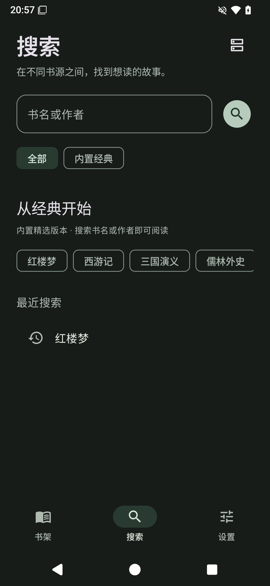

# 万卷

Android 小说阅读器，支持导入本地 TXT、EPUB 和在线书源。书架、阅读进度和设置保存在本机，无需账号。

- Android 10（API 29）及以后，无需账号。
- 导入 TXT / 文字 EPUB，自动识别章节、保存阅读位置。
- 内置维基文库与 Project Gutenberg 经典小说入口，支持简繁书名和作者搜索。
- 导入多个阅读 / Legado JSON 书源，多源搜索、目录、正文、手动换源。
- 分页与滚动阅读、自定义字体、字号、行距、主题、背景、音量键翻页、单书设置。
- 书签与笔记、离线下载、存储管理、本地备份（可含已下载正文）、HTTPS WebDAV 备份。
- 从本仓库 GitHub Releases 检查更新，验证哈希、包名、版本和签名后交给系统安装。

## 安装

在本仓库 [Releases](https://github.com/GodBook/wanjuan/releases/latest) 下载 `wanjuan-*.apk`。正式版本使用同一发布签名，可以覆盖升级。更新入口：**设置 → 检查更新**。首次应用内升级需要在系统页面允许万卷安装应用，再返回点击“安装更新”。

内置两个经典书源，提供《红楼梦》《西游记》《三国演义》《儒林外史》等书的指定版本，不支持全站搜索。首次读取在线正文需要联网，也可以导入自己的书源。详见 [内置书源说明](docs/BUILTIN_SOURCES.md)；支持的 Legado 规则范围见 [兼容清单](docs/SOURCE_COMPATIBILITY.md)。

## 实机界面

以下为 Android 15 实体手机实测界面，正文展示内置维基文库版本《红楼梦》。

  

0.1.3 完善离线备份与中断恢复、换源后的书签保护、下载暂停继续和阅读失败反馈，并将阅读进度独立存储。当前版本的设备、规模和发布验证见 [验证记录](docs/TESTING.md)，更新内容见 [0.1.3 更新说明](docs/releases/0.1.3.md)。

历史性能测量及测试条件见[验证记录](docs/TESTING.md)，其中 0.1.1 的对照数据不代表当前版本的整体性能。

## 开发

环境：JDK 17、Android SDK 35、Gradle Wrapper 8.14.2。

```shell
./gradlew :app:assembleDebug :app:testDebugUnitTest :app:lintDebug
./gradlew :app:assembleDebugAndroidTest
```

调试包名 `io.github.godbook.wanjuan.debug`，发布包名 `io.github.godbook.wanjuan`，二者数据隔离。选择明确的设备序列号运行设备测试，避免误用其他已连接设备。

Windows 可以用 `scripts/test-device.ps1 -Serial <adb序列号>` 安装调试包并执行测试。

发布签名配置不进入 Git。请阅读 [发布与在线更新](docs/RELEASING.md)。

## 文档

- [后续更新与优化建议](docs/UPDATE_PLAN.md)
- [当前更新执行状态](docs/EXECUTION.md)
- [软件设计与实现边界](docs/DESIGN.md)
- [书源规则兼容清单](docs/SOURCE_COMPATIBILITY.md)
- [发布与在线更新](docs/RELEASING.md)
- [验证记录](docs/TESTING.md)
- [隐私说明](PRIVACY.md)

## 已知限制

当前为 **0.1.3**。不支持所有 Legado 扩展接口、动态网页和复杂登录；EPUB 支持文字与基础内嵌图片，不还原复杂 CSS 或固定版式。WebDAV 支持手动/每日快照备份，不是实时同步。不提供听书、仿真翻页或插件系统。新格式备份可读取旧版数据，旧版应用不能恢复新格式备份；单文件限 100MiB，解压总量限 512MiB。

[MIT License](LICENSE)。
