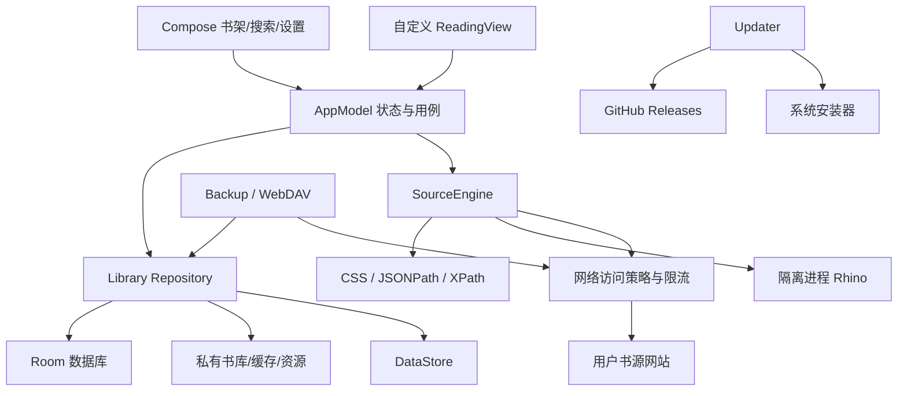

# 万卷 · 软件设计文档

版本：V1.0 设计基线；实现版本：0.1.0。日期：2026-10-15。

本文将长期产品设计与当前实现状态分别记录，避免把设计目标误认为已验证结果。

## 1. 产品目标

万卷是一款 Android 原生文字小说阅读器：本地优先、无需账号、界面简洁，支持用户导入多个书源并深度定制阅读体验。

主要用户是长期阅读中文小说、拥有本地电子书或自备网络书源的 Android 用户。支持 Android 10 及以后，手机竖屏为主要布局，兼顾横屏。

成功标准：从书架快速续读；多书源部分失败不阻塞其他结果；缓存内容断网可读；修改排版和重新启动后保留文字位置；备份可验证可恢复；同签名新版本能够覆盖升级并保留用户数据。

不包含账号系统、广告、信息流、社交、漫画、PDF、听书、仿真翻页或插件体系。不内置小说网站书源。

## 2. 界面与交互

### 2.1 信息架构

底部三个入口：书架、搜索、设置。阅读页面独立，进入后隐藏底部导航。

| 页面 | 功能 | 空白与错误状态 |
|---|---|---|
| 书架 | 网格/列表、最近阅读、按名排序、分组、置顶、已读完 | 引导本地导入 |
| 搜索 | 搜索词、书源分组、流式结果、取消、失败列表 | 无书源引导、无结果说明 |
| 书源 | 文件/粘贴/链接导入、兼容预览、启停、分组、检测、导出 | JSON 错误、部分兼容 |
| 阅读 | 正文、页码、目录、进度、换源、设置、书签笔记 | 正文失败后可重试/返回 |
| 下载 | 持久任务队列、进度、取消、重试 | 等待网络、失败原因 |
| 备份 | 文件导出、恢复预览、HTTPS WebDAV | 校验失败、版本不支持 |
| 更新 | 查询新版本、下载验证、系统安装 | 网络失败、签名不一致 |

### 2.2 视觉

应用使用中性浅色与低饱和绿色，深色主题独立适配。内容以文字层级和留白组织，少量圆角承载可交互区域。书架封面缺失时生成书名封面。

触控目标按 48dp 设计。阅读主题独立于应用主题。系统界面使用无衬线字体，正文允许自定义 TTF/OTF。浅色、深色和跟随系统设置持久化。

### 2.3 阅读操作

左侧点击上一页，右侧点击下一页，中央点击菜单。支持左右滑动、交换左右手点击、音量键翻页、上下滚动、无动画。长按打开可选择文字视图。返回按面板、菜单、阅读页面的层级处理。

默认字号 20sp、行高倍数 1.6、左右页边距 24dp、首行缩进两字符，跟随系统亮度。单书设置只保存相对全局的差异字段。预设可在设备内命名保存和切换。

## 3. 架构与模块

### 3.1 技术决策

| 决策 | 选择与原因 | 代价 |
|---|---|---|
| Android 客户端 | Kotlin 原生，对文字布局与设备行为控制直接 | 跨平台需另外实现 |
| UI | Compose + 原生正文 View，兼顾页面开发效率与分页控制 | 需要互操作与生命周期处理 |
| 数据 | Room 记录表 + 版本化 JSON 负载 + 私有文件 | 灵活但不适合复杂 SQL；未来实体拆表需迁移 |
| 设置 | DataStore，全局设置与业务数据分开 | 备份需同时收集两种数据 |
| 正文 | StaticLayout，后台分页、主线程绘制 | 复杂 EPUB 图文排版需要继续扩展 |
| 脚本 | 隔离进程 Rhino，仅纯计算 | 覆盖较小的兼容子集 |
| 后台 | WorkManager，持久任务、网络约束 | 执行时间由系统调度 |
| 云端 | 用户 WebDAV 快照，无自建服务 | 不提供自动冲突合并 |
| 更新 | GitHub Release + 同签名 APK 验证 | GitHub 网络可达性影响下载 |

单应用、单数据库，不部署微服务。模块通过 Repository 和显式方法交互，不引入事件总线。

### 3.2 核心数据

| 类型 | 字段与用途 |
|---|---|
| Source | 内部 ID、原始 JSON、启用状态、HTTP 授权、检测状态 |
| Book | ID、书名、作者、当前来源、目录、进度、锚点、分组、置顶、配置差异 |
| Chapter | ID、标题、远端 URL 或本地文件路径 |
| Mark | 书籍 ID、章节位置、字符偏移、摘录、笔记 |
| Profile | 字体、颜色、排版、翻页、亮度、操作、正文替换 |
| Record | kind + id 联合主键、payload，当前数据库的持久记录格式 |

设计目标中独立的 BookEdition 在首版以内嵌当前版本字段表达。换源保留 Book ID，用户必须选择目标章节；历史版本目录暂不单独保留。

### 3.3 接口契约

- `SourceEngine.inspect`：静态解析导入并给出警告，不执行脚本。
- `SourceEngine.search`：Flow 逐书源返回结果或结构化失败信息。
- `SourceEngine.catalog/content`：按配置获取目录/正文，错误不返回伪造空结果。
- `Library.progress`：保存章节、字符偏移和短文本锚点。
- `Backup.create/inspect/restore`：生成归档、预览、校验后恢复。
- `Updater.check/download/verify/install`：版本查询、下载、签名校验、系统安装。

## 4. 内容与阅读数据流

### 4.1 书源

导入 JSON → 静态能力提示 → 确认 → 保存 → 用户启用/检测 → 搜索 → 详情/目录 → 正文 → 文件缓存。

书源 ID 来自规范化 URL 的 SHA-256。重复时允许替换或跳过。导入不会访问全部网站。HTTP 默认为禁止，需要逐源开启。脚本不能读取文件、网络、Java 反射或 Android 对象。

搜索全局并发 6、每主机并发 2、单书源 12 秒预算。结果实时出现，取消时取消网络 Call。书名和作者相同的候选聚合展示，作者未知的结果不跨源合并。

目录/正文分页有次数上限与重复链接检测。所有受支持语法列于 `SOURCE_COMPATIBILITY.md`，不承诺整体 Legado 兼容。

### 4.2 本地文件

系统文件选择器授权读取。导入文件复制到私有书库。TXT 支持 UTF-8、UTF-16、GB18030 自动检测及手动指定；按标题识别章节，未识别时分段。EPUB 按 container → OPF → spine 顺序读取文字章节。首版最多导入 100MB 文件，解压数量和体积受限制。

### 4.3 排版与定位

原始缓存 → 文本清洗 → 用户替换 → 首行缩进 → 后台布局 → 按可用高度分页 → 绘制。

位置包含章节 ID/索引、字符偏移、后续短文本锚点。布局改变后优先原偏移；文本变化时搜索锚点；无法匹配时限制到有效偏移范围。进度在稳定翻页后短暂合并写入，退出和进入后台再次刷新。

页码仅用于显示，不作为持久位置。旋转和排版变化会取消旧任务，旧布局不能覆盖新布局。相邻三章预取；正文缓存以章节 ID 命名。

### 4.4 缓存与下载

临时缓存与用户下载通过离线标记区分。显式下载由 WorkManager 持久调度，默认 Wi-Fi。重复请求用唯一工作名约束，已落盘章节跳过。文件先写临时路径，再原子替换。

## 5. 备份、安全与一致性

### 5.1 备份结构

ZIP 包含 `state.json`、`manifest.json` 和可选书库文件。清单记录每个文件 SHA-256，恢复拒绝重复条目、未知路径、路径穿越、超量解压、错误格式版本和校验失败。

恢复前创建本地快照。先验证并解压到暂存目录，然后在互斥锁和数据库事务下替换文件/数据；异常回退到原书库。WebDAV 密码不进入备份。

### 5.2 一致性与幂等

数据库是书架和进度的权威来源。文件写入完成后才提交书籍记录；失败导入可能留下未引用文件，需要后续清理。恢复通过完整快照工作，不合并多设备状态。无分布式数据库，CP/AP 标签不适用于本地 Room；断网时继续本地读写，外部请求报错。

### 5.3 安全边界

无账号、广告或遥测。网络验证目标地址与重定向，不把敏感请求头转发给跨主机目标；默认禁止书源访问私网。WebDAV 允许用户显式配置私有 HTTPS 服务。脚本采用 Android isolatedProcess，指令预算与调用超时共同约束。字体和图片限制输入大小。

## 6. 发布与在线更新

包名固定，签名密钥永久保留在仓库外。GitHub Releases 提供 APK、SHA256SUMS 和 update.json。更新只接受更高 versionCode，校验实际 APK 签名和包名，使用系统安装器确认。不会静默安装或要求用户卸载旧版。

CI 对普通提交执行测试和 Lint；签名发布由手动工作流触发，PR 无权使用签名 Secrets。

## 7. 性能与测试策略

设计预算：中端 Android 10 / 4GB 基线上冷启动 P95 ≤ 2 秒、缓存章节打开 ≤ 500ms、已布局翻页响应 ≤ 50ms、常规阅读内存目标 ≤ 200MB。**这些数字是目标，未做基线测量前不得写成已达到。**

测试层次：纯逻辑 JVM 测试；设备端本地数据库/备份/脚本/内容链测试；实体手机界面与安装升级；Android 10 最低版本兼容测试；Release 构建/Lint/签名验证。证据见 `TESTING.md`。

| 风险 | 缓解 | 验收归属 |
|---|---|---|
| 外部规则不兼容 | 明确子集、固定响应回归 | 书源 |
| 换源章节错位 | 用户确认目标章节、文本锚点 | 阅读 |
| 脚本超时或内存异常 | 隔离进程、预算、销毁 | 引擎 |
| 恢复中断 | 校验、快照、事务、回退 | 数据 |
| 更新包被替换 | 哈希 + 原签名 + 版本校验 | 发布 |
| 系统限制后台 | 持久任务、显示等待状态、手动重试 | 下载 |

## 8. 当前实现与后续差距

当前已构建本地/在线阅读主流程、常用规则子集、自定义排版、书签笔记、手动换源、下载、文件/WebDAV 备份和在线更新。以下设计目标需要继续补足，不能作为 0.1.0 已完成能力宣传：

- EPUB 复杂富文本样式的完整还原；当前支持文字和基础插图，TXT 已采用分段读取。
- 多分组归属、批量书架操作、拖拽排序、远端封面加载。
- 完整章节版本实体、跨版本笔记重定位和章节比例回退。
- 通用点击区域映射、多条带作用域正文替换、繁简转换、独立预设导入导出。
- 完整书源变量语法、宿主辅助函数、熔断与限流退避。
- 书架更新状态定期检查；下载已采用 20 章批次并支持暂停、继续和缓存清理。
- WebDAV 大文件可中断上传恢复；每日备份和按设备保留 10 份快照已实现。
- 数据库升级迁移样本、恢复中断日志的故障注入测试、2 小时稳定性和量化性能基线。

设计评审结论：适合进入真实设备测试和初始版本迭代，不应宣称已经满足完整 V1 的全部验收门槛。
